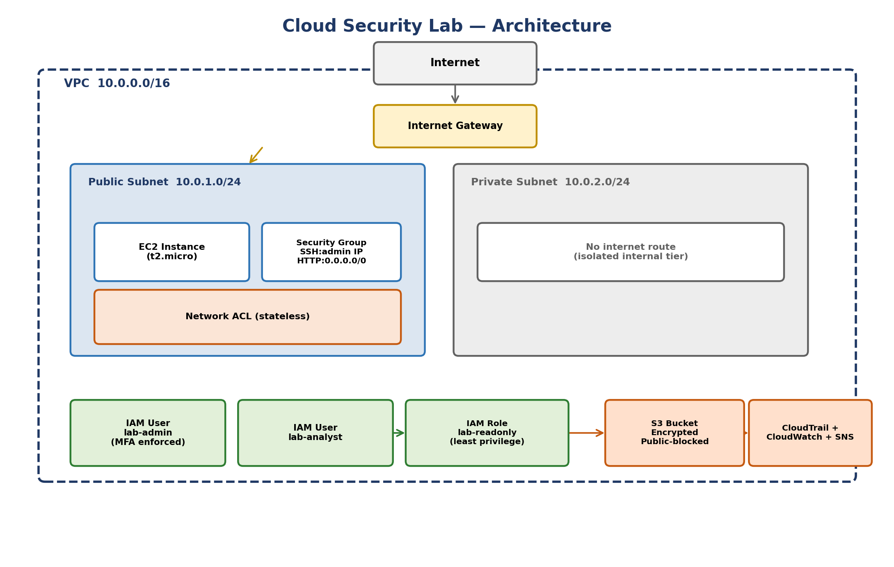

# Cloud Security Lab — Infrastructure as Code

Terraform configuration implementing a secure AWS lab environment for the
Cloud Security Engineer internship (Task 2: Hands-On Lab Implementation).

## What this builds

- **VPC** with segmented public/private subnets (`network.tf`)
- **IAM** least-privilege users and roles, MFA-enforced admin (`iam.tf`)
- **Security Groups + NACLs** restricting inbound access (`network.tf`)
- **S3** bucket with encryption, versioning, and public access blocked (`storage.tf`)
- **CloudTrail + CloudWatch + SNS** for logging, monitoring, and alerts (`monitoring.tf`)

## Architecture



## Usage

```bash
terraform init
terraform plan -var="admin_ip_cidr=YOUR_IP/32" -var="alert_email=you@example.com"
terraform apply -var="admin_ip_cidr=YOUR_IP/32" -var="alert_email=you@example.com"
```

## Why Infrastructure as Code

Written as Terraform rather than manual console clicks so that every
resource, permission, and network rule is version-controlled, peer
reviewable, and reproducible — avoiding the undocumented manual
configuration drift that causes many real-world cloud security
incidents.

## Status

Syntax-validated (HCL parse-checked). Not yet applied against a live
AWS account pending account verification.
